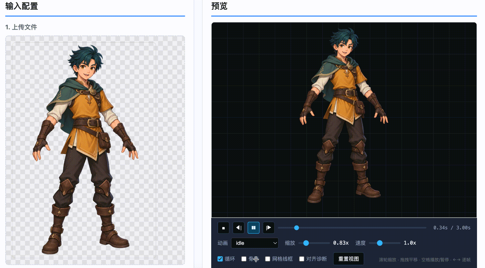
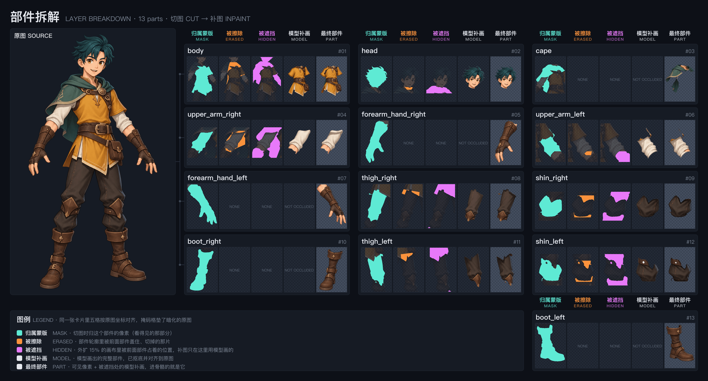

# Spine AI Generator

**English | [中文](README.md)**

<p>
  <a href="LICENSE"></a>
  
  
  
</p>

A local tool that **splits a 2D illustration into parts, builds a skeleton, and exports a Spine project** — automatically.

Upload an image → a vision model figures out which parts exist and what covers what → pixel-level
cutout → bone hierarchy is inferred → one click exports Spine assets for your target platform
(Cocos / Unity / LayaAir / Phaser / PixiJS / Spine editor 4.0–4.2), plus a `.spine` project you can open directly in the editor.

<p align="center">
  
</p>

<p align="center">
  
</p>

---

## Contents

- [What this is](#what-this-is)
- [Pipeline](#pipeline)
- [Minimal viable scope](#minimal-viable-scope)
- [Quick start](#quick-start)
- [Workflow](#workflow)
- [Output layout](#output-layout)
- [Tech stack](#tech-stack)
- [Configuration](#configuration)
- [FAQ](#faq)
- [Documentation](#documentation)
- [Development](#development)

---

## What this is

Building a 2D game character with skeletal animation means manually splitting an illustration into
head, body, arms, accessories… then building bones, painting weights, and ordering draw calls in
Spine. It's repetitive and slow. This tool automates that stretch:

| Step | By hand | This tool |
|---|---|---|
| Split parts | Cut each one out in an image editor | Vision model lists parts + pixel-level segmentation |
| Build hierarchy | Reason out each parent/child by hand | Inferred from occlusion relationships |
| Place bones | Position manually, guess pivots | Pivots derived from part bboxes and pose |
| Build meshes | Draw edges and paint weights along seams | Grid triangulation + annulus stitching, shared seam weights |
| Fill occlusions | Clone-stamp what's hidden | Image model infers the covered regions |
| Export | Configure each skeleton/atlas | One click, multiple target formats |

**This is not "one-click finished animation."** What it produces is **a clean, editable starting
point**: parts separated, hierarchy built, weights painted. An artist picks up from there to tune
meshes and keyframes rather than starting from a blank project.

> Quality depends on the source art. Character illustrations with clear part boundaries and
> unambiguous occlusion work best. Heavily interleaved parts, or lots of semi-transparency,
> will need manual cleanup.

---

## Pipeline

Every stage has its own quality gate: if it fails, the stage retries rather than passing bad output downstream.

```
Source image
   │
   ▼
Stage 0: Scene understanding                        vision model
   │  ├─ which parts exist, what covers what
   │  ├─ BBox (coarse position) / Pivot (the joint)
   │  ├─ Parent (hierarchy) / Depth (draw order)
   │  └─ polygon outline (optional; the SAM fallback path uses it)
   │        │
   │   JSON truncated (stop_reason=max_tokens) → retry with a bigger budget
   ▼
Stage 1: Cutout / layering                          MobileSAM / SAM 3 (optional)
   │  ├─ BBox (MobileSAM) or part name (SAM 3) as the prompt → per-pixel mask
   │  │     no SAM installed? fall back to stage 0's polygon; nothing breaks
   │  ├─ exclusive ownership: overlapping pixels go to the highest depth
   │  ├─ clamp each mask back inside its own box (a small accessory must not
   │  │     erase a large part)
   │  ├─ claim unowned pixels by connectivity, and widen the window to fit
   │  ├─ pen edges: front-layer cuts snap to the outer side of the ink line
   │  │     (applied to the ownership table)
   │  ├─ write RGBA cutouts: Bézier cut edges, colour-unmixed anti-aliasing,
   │  │     alpha bleed
   │  └─ write three masks (only alpha is meaningful)
   │        .mask.png    ownership: pixels that belong to this part
   │        .erased.png  erased: the part's area covered by front parts
   │        .hidden.png  hidden: positions taken by front parts on a canvas
   │                     padded 15% around the window
   │        │
   │   alignment diagnostics → written to the log; no automatic re-cut
   ▼
Stage 2: Occlusion inpainting                       image model (optional)
   │  ├─ parts without a .hidden.png (nothing in front) are skipped
   │  ├─ white canvas + magenta stripes over hidden areas → the model draws
   │  │     the whole part
   │  ├─ key out the white, resize to the canvas, split white mixed into the
   │  │     outline into partial alpha (no white halo)
   │  ├─ register against the visible pixels; take the model's pixels only
   │  │     where hidden, keep the original everywhere visible
   │  │     the aligned model image is saved to _inpaint/ at canvas size
   │  └─ per-round API failure → backoff, 3 retries (transient status codes only)
   │        │
   │   score by colour error, coverage and leftover magenta
   │   ┌────┴────┐
   │   │         │
   │  fails    passes, or the configured rounds are spent
   │   │         │
   │   ▼         ▼
   │ draw      use the best round; none usable → smooth colour fill inside
   │ again     the part's outline as a fallback
   ▼
Stage 3: Skeleton
   │  ├─ Bone: topological order + one synthetic root
   │  │     (the Spine editor accepts exactly one root)
   │  ├─ Mesh: grid triangulation + annulus stitching
   │  ├─ Weight: seam vertices follow the parent bone fully, handing over to the own bone toward the tip; ≤ 4 bones per vertex
   │  ├─ Pivot → bone origin; pixel coords → Spine coords (centred, Y flipped)
   │  └─ Slots sorted by depth = draw order
   ▼
Stage 4: Animation + export
   │  ├─ generate idle (standing breath: the whole character stretches ~1.3% vertically, anchored at the soles; every part shares one transform so seams never open; only the head sways 0.6°)
   │  ├─ convert for the target platform: Cocos / Unity / LayaAir / Phaser / PixiJS / Spine 4.0–4.2
   │  │     version differences: 3.8 uses angle, 4.0+ uses value;
   │  │     skins is an object in 3.8 and an array in 4.x
   │  ├─ pack the atlas; inline weights into the vertices stream
   │  └─ invoke the Spine editor CLI to produce .spine
   │        │
   │   ┌────┴────┐
   │   │         │
   │ CLI      success
   │ rejects     │
   │   │         │
   │   ▼         ▼
   │ error →   artefacts written
   │ README.txt  (see "Output layout")
   │   │         │
   │   └────┬────┘
   ▼        ▼
inspect the assembly and idle in the preview → export Spine assets
```

### What each stage is actually solving

| Stage | Problem it solves | If you skipped it | Quality gate |
|---|---|---|---|
| 0 Scene understanding | Which parts exist, what covers what | No idea how many pieces to cut | Retry on truncated JSON |
| 1 Cutout / layering | Exact pixel boundary per part | Cutouts overlap; parts interpenetrate when rotated | Alignment diagnostics to the log |
| 2 Occlusion inpainting | Covered regions are empty | Rotating a part reveals a hole | Re-fill if botched > 2% |
| 3 Skeleton | Hierarchy, pivots, draw order, seam weights | Everything breaks once it moves; seams tear | Pure computation, no gate |
| 4 Animation + export | A format the target platform can load | Can't get it into a project | Error out if the Spine CLI rejects it |

Base plate and hole guards (`_base_plate` plus the fill guard) run through stage 2: a full-image
backing layer covers seams that don't quite meet, and near-white / near-black / mid-dark fills are
judged botched and replaced with neighbourhood ground truth. Skip them and you get black patches on
the base plate and white specks in the cutouts.

---

## Minimal viable scope

**The core pipeline needs only Node plus an API key.** Everything else is optional:

| Feature | Requires | Without it |
|---|---|---|
| AI part analysis | **Required**: a vision model API key | The tool can't work |
| Cutout / assembly / skeleton / export | **Required**: Node 20+ | The tool can't work |
| Pixel-level segmentation | Optional: MobileSAM (~800MB) | Falls back to polygon masks — coarser edges, still works |
| Occlusion inpainting | Optional: an image generation model | Covered regions stay transparent; parts look holed in isolation |
| `.spine` project | Optional: Spine 4.x installed locally | Target-platform assets still export; you just lose the editable project |

In other words: **`npm install` plus an API key gets you assets your target platform can load.** Install the other three
as needed — any one of them missing only affects that one artifact, never the whole pipeline.

---

## Quick start

```bash
# 1. Dependencies
npm install

# 2. Configure the API (either way)
cp .env.example .env
#   then edit .env and set ANTHROPIC_API_KEY
#   using a self-hosted gateway or relay? also set ANTHROPIC_BASE_URL
#   alternatively skip .env entirely and fill the form in the web UI

# 3. Run
npm run web
# → http://localhost:3000
```

No Python environment and no Spine editor needed to produce a usable project.

**Optional extras:**

```bash
# Pixel-level segmentation: creates a venv and pulls weights (~800MB, one-time)
npm run sam:setup && npm run sam:check

# .spine project: just install Spine 4.x; common locations are found automatically.
# Installed elsewhere? set SPINE_CLI_PATH
```

---

## Workflow

| # | In the UI | Under the hood |
|---|---|---|
| 1 | Upload an illustration PNG | Dimensions read, pixel coordinate system established |
| 2 | Write a prompt describing part structure and pivots | Prompt quality drives part-table quality — [see below](#writing-the-prompt) |
| 3 | Pick a target platform (Cocos 3.8 / Unity / LayaAir / Phaser / PixiJS / Spine 4.0–4.2) | Determines skeleton version, rotation key name and skins shape |
| 4 | Click Generate | Runs stages 0–3; the log panel streams live |
| 5 | Check the assembled preview, play the idle animation | Seams or colour artefacts show up immediately |
| 6 | Click Export | Runs stage 4, producing the target-platform assets plus `.spine` |

### Writing the prompt

Four built-in templates (character / prop / effect / item), editable via the **Settings** button
next to "2. 提示词". They live in `config/prompt-templates.json`.

The key is **describing structure and pivots**, not describing the picture:

```
✅ Good
   A female character, left hand on hip, right hand holding scissors.
   Parts: head, hair bun, glasses, body, apron, left arm, right arm
   (including scissors), shoes.
   Head rotates around the neck; arms rotate around the shoulders;
   apron rotates around the waist.
   Draw order: body → apron → arms → head → hair bun → glasses.

❌ Bad
   An angry woman
   (no parts, no hierarchy, no pivots)
```

### Built-in templates

All four live in `config/prompt-templates.json` and are editable in the UI. What they control is
not *what to draw* but **how to split, how to set parents, and where the pivots go**:

| Template | Splitting strategy | Pivots | Part count |
|---|---|---|---|
| Character | Body is the root; clothing layered inside-out; hand and held prop **must be merged** (split them and you get a guaranteed gap) | Head at the neck base, upper arm at the shoulder, forearm at the elbow, hand at the wrist | 6–15 |
| Prop | Main body is the root; split by **real motion** (a wheel that turns, a trigger that pulls) | On the actual axis of rotation | 4–10 |
| Effect | Layered by distance from the core; the outermost layer draws on top | Almost always the geometric centre, so scaling and rotating expands outward naturally | 3–8 |
| Item | **Only split what moves**; a purely decorative object is one part | Hinge / axis | 1–5 |

Three rules are shared by all four templates and live in their body text:

- **Hierarchy**: "the thing on top is the child, the thing underneath is the parent" — the occluded
  part is the parent (drawn first), the occluder is the child (drawn on top)
- **bbox padding**: extend 3–5 px past the visible content so the outline is included; better to
  over-frame by 5 px than under-frame by 1 px
- **Pivots**: place them at the real joint, not at the part's geometric centre

---

## Output layout

```
output/<project name>/
│
├── <source name>_temp/                 ← intermediates; kept for re-inpainting
│   └── Image/
│       ├── <part>.png                  part image (after inpainting; this goes into the skeleton)
│       ├── <part>.mask.png             ownership mask (alpha)
│       ├── <part>.erased.png           erased area (alpha)
│       ├── <part>.hidden.png           hidden area = inpaint canvas (alpha; absent if nothing is in front)
│       ├── _inpaint/<part>-<round>.png the model's whole-part drawing, aligned to the canvas
│       └── verify-input.json           input snapshot for verification
│
└── <source name>/
    ├── Spine工程/
    │   └── <source name>.spine         ← opens directly in the Spine editor
    │
    └── <target>/                       cocos-3.8 / unity / spine-4.2 ...
        └── <source name>/
            ├── <source name>.json      skeleton
            ├── <source name>.atlas     atlas descriptor
            ├── <source name>.png       atlas page
            ├── images/                 loose parts (for mesh editing back in the editor)
            └── README.txt              parameters and results of this export
```

**Why intermediates live in `_temp/`**: re-inpainting and re-cutting read from there. Clearing it on
export would mean re-running the expensive AI stages. Each export target gets its own directory
because 3.8 and 4.x skeleton/atlas formats are mutually incompatible — flattened together they'd
overwrite each other. Re-exporting Cocos leaves Unity untouched.

---

## Tech stack

| Layer | What | Why |
|---|---|---|
| Runtime | **Node.js 20+** (ESM) | No build step anywhere; edit and run |
| Web server | **Express** + SSE | SSE streams the log; pipeline progress is visible live |
| Image processing | **sharp** | Native libvips; cutting, compositing, assembly all in milliseconds |
| Vision | **Claude vision model** | Needs structured JSON (a part table), not a description of the picture |
| Inpainting | **Image generation model** (optional) | Reconstructs occluded regions |
| Segmentation | **MobileSAM** (optional, Python) | Bboxes as prompts for exact masks |
| Editor integration | **Spine CLI** (optional) | `.spine` is a private binary format only the official CLI can write |
| Browser tests | **Playwright** (dev) | UI regression |
| Frontend | Plain JS, no framework | Single-page tool; a framework would be overhead |

### A few deliberate trade-offs

**Why keep a polygon fallback instead of making SAM mandatory**: SAM needs an 800MB Python
environment, and plenty of people just want to see whether this works at all. The fallback uses the
polygons the vision model already returns — slightly coarser, zero dependencies — so you can run the
whole pipeline before deciding whether to install anything.

**Why `.spine` isn't generated in-house**: it's Spine's private binary project format (raw-deflate
wrapping a token stream) with no public spec, and it changes between 4.x patch versions. A
reverse-engineered writer would silently corrupt on an editor upgrade — worse than not producing it.
So it goes through the officially supported CLI.

**Why SSE rather than WebSocket**: logs are one-directional. SSE is sufficient, reconnects on its
own, and saves a handshake layer.

---

## Configuration

Everything lives in `.env` (see `.env.example`; gitignored).

| Variable | Default | Purpose |
|---|---|---|
| `ANTHROPIC_API_KEY` | empty | API key, required (can also be set in the UI) |
| `ANTHROPIC_BASE_URL` | empty | Empty = direct to Anthropic. Set it for a self-hosted gateway or relay |
| `PORT` | `3000` | Listen port |
| `OUTPUT_DIR` | `./output` | Artifact root |
| `SPINE_CLI_PATH` | auto-detected | Spine editor executable |
| `SPINE_SAM_HOME` | `~/.spine-tool/mobilesam` | MobileSAM environment location |

**Changing the API endpoint**: edit `config/api-defaults.json` — the UI form reads its defaults from
there, so there's no hunting through code. Values in `.env` take precedence and are machine-local.

---

## FAQ

**Does it need network access?**
Analysis, inpainting, and segmentation call models, so yes. Cutting, assembly, skeleton generation,
and export are entirely local.

**Can I use it without installing MobileSAM?**
Yes. It falls back to polygon masks — coarser edges, complete pipeline. Worth a run before you
decide whether to install SAM.

**Parts came out broken, or there are black patches / white specks.**
Check the log panel for inpainting failures first; **Retry inpainting** re-runs only the failed ones.
The fill guards classify near-white, near-black, and mid-dark fills as failed and substitute
neighbouring real pixels.

**Skeleton is missing parts, or the hierarchy is wrong.**
Almost always the prompt. Go back to step 2 and state the part list, hierarchy, and pivots
explicitly, then regenerate. You can edit the templates in the UI directly.

**Can Spine open the export directly?**
The `.json` is **imported** into Spine (new project, then import). The `.spine` is **opened**. Both
are in the export directory; `.spine` sits under `Spine工程/`.

**Which input formats?**
PNG / JPG / WebP. Use PNG if you need transparency.

**Why is there a `_base_plate` part?**
It's a full-image backing layer that covers hairline seams between parts. Don't want it? Ask for no
base plate in the prompt, or delete it after generation.

---

## Documentation

| Document | Contents |
|---|---|
| [Web service usage](docs/guides/web-service.md) | UI walkthrough, prompt tips, environment variables |
| [Background removal & inpainting](docs/guides/background-removal.md) | Full technical detail and pitfalls of the inpainting pipeline |
| [Depth-based erasure](docs/notes/depth-based-erasure.md) | Why parts are assigned by depth |
| [MobileSAM feasibility](docs/notes/mobilesam-feasibility.md) | Why MobileSAM, measured data, prompt strategy comparison |

> These are written in Chinese — they're investigation records from development. `docs/notes/`
> documents how a specific problem was diagnosed and measured; if you want to know why some design
> decision was made, the measurements are usually in there.

---

## Development

```bash
npm install              # install

npm run web              # start the server
npm test                 # unit tests
npm run test:e2e         # end-to-end (really calls the API; slow)
npm run test:shot        # UI screenshot regression
npm run verify           # validate artifact structure
npm run shot             # capture preview screenshots
npm run check            # environment self-check
npm run sam:check        # MobileSAM environment status
```

### Layout

```
server/
├── index.js             HTTP routes + SSE log stream
├── generate-cli.js      CLI entry point
├── ai/
│   ├── claude.js        Vision: image → part table
│   ├── models.js        Text/vision model list
│   ├── image-models.js  Image generation model list
│   └── api-defaults.js  Endpoint defaults (reads config/api-defaults.json)
├── api/
│   ├── cutter.js        Cutout: masks → isolated PNGs
│   ├── isolate.js       Part isolation: overlap ownership, orphan claiming
│   ├── mesh.js          Grid triangulation + annulus stitching
│   ├── generator.js     Skeleton and animation generation
│   ├── targets.js       Target adaptation (3.8 vs 4.x shape differences)
│   ├── atlas.js         Atlas packing
│   ├── spine-project.js Spine CLI interaction, writes .spine
│   ├── inpaint.js       Occlusion inpainting
│   ├── background.js    Background removal
│   ├── baseplate.js     Base plate
│   ├── workspace.js     Directory layout (single source of truth)
│   └── env-file.js      .env read/write
└── sam/                 MobileSAM integration (optional)
    ├── client.mjs       Long-lived process client
    ├── worker.py        Python worker
    └── setup.mjs        One-command environment setup

web/                     Frontend (plain JS, no framework)
src/                     Standalone Spine read/write library (JSON/binary parsing, round-trip, validation)
scripts/                 Utility scripts
docs/                    Documentation and images
config/                  prompt-templates.json, api-defaults.json
temp/test/               Tests
```

The Spine read/write library under `src/` is usable standalone — it doesn't depend on `server/` and
is handy for skeleton format conversion.

---

## License

[Apache License 2.0](LICENSE).

Third-party components (MobileSAM, sharp, Playwright, …) are not distributed with this
repository — they are fetched from upstream at install time and keep their own licenses;
see [NOTICE](NOTICE). `.spine` files are produced by invoking a Spine editor CLI you already
have installed; no Spine editor code is included or redistributed here.
