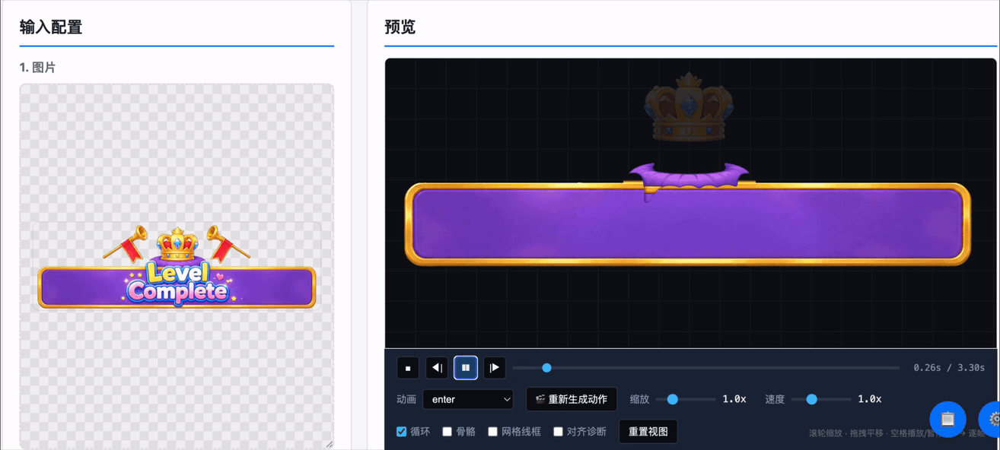
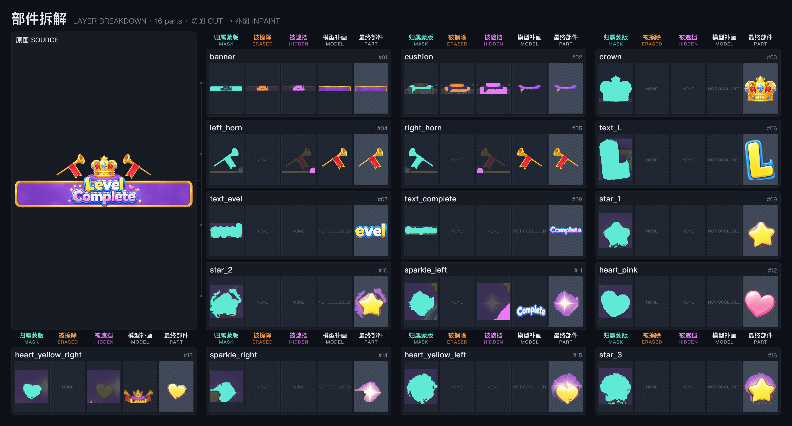
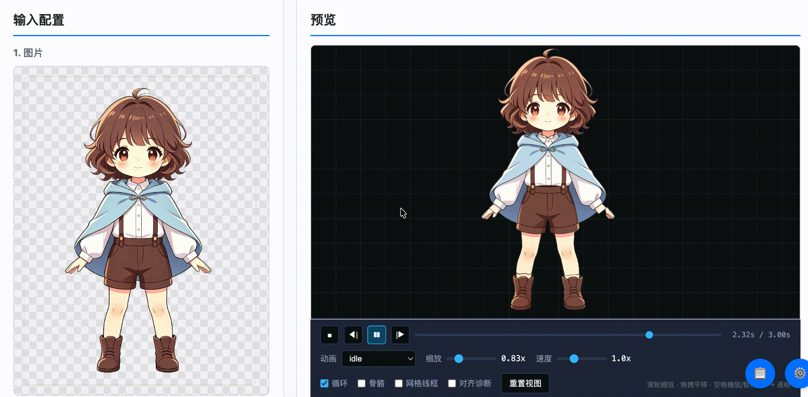
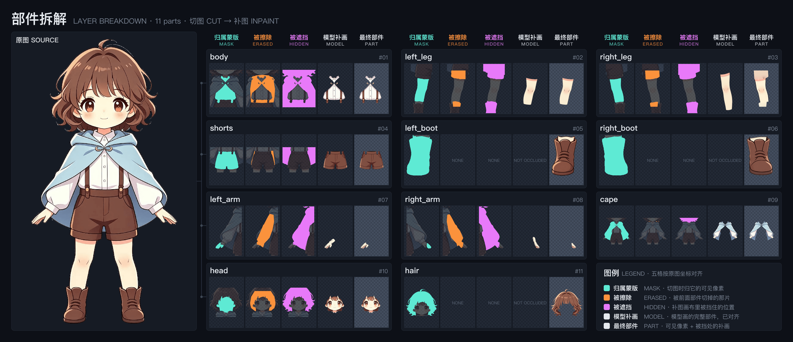

# More examples

[中文](examples.md)

Each example is a single generation run from the web UI. The top image is a recording of the preview; the bottom one is the
layer breakdown (source on the left; each part shows five cells in pipeline order: ownership mask → erased → hidden →
model drawing → final part).

> **Details may need fine-tuning.** Part granularity, the shape filled in behind occluders, pivot positions and motion
> timing are not always right on the first run, and the same prompt can give somewhat different results each time.
> Most issues can be fixed by editing the prompt and regenerating; for finer points (one part filled in badly, one
> motion segment not smooth) you can hand it to an agent, describe what you see, and have it adjust that one spot.

- [UI animation: Level Complete screen](#ui-animation-level-complete-screen)
- [Character: girl with short hair](#character-girl-with-short-hair)

---

## UI animation: Level Complete screen

<p align="center">
  
</p>

<p align="center">
  
</p>

**Settings**: category "UI动效" (UI animation), "按提示词生成动作" (generate motion from prompt) checked, motion name `enter`.
Split into 16 parts; produces an `enter` animation (3.3 s) and an `idle` animation.

**Reference prompt** (part split and motion in one prompt). The run used the Chinese original on the
[Chinese page](examples.md); this is an English translation:

```
This is a game result screen "Level Complete", not a character. Split it into these parts:
Banner: the purple strip spanning the whole bottom of the image, with a gold border; the areas covered by the text, cushion and stars also belong to the banner.
Stars: the small yellow stars, small hearts and white sparkles scattered on the banner. Each one is its own part, a child of the banner, with its pivot at its own center.
Cushion: the round, puffy purple cushion right above the banner. It is a complete oval pillow, rounded and full all around, with radial folds on its surface; its lower half is hidden by the word "Level". Its bottom edge is a smooth arc, with no gold border, no feet and no sharp corners. The crown sits on it.
Crown: the gold crown on the cushion, including the sapphires and the red velvet lining.
Left horn, right horn: the two long gold horns held up at an angle on each side, each including the mouthpiece, the tube and the red swallowtail flag hanging from the tube.
Text Level: the big yellow word "Level". The capital "L" is its own part and "evel" is another; neither contains the other.
Text Complete: the white "Complete" with a blue outline below.

Result entrance animation, 3.3 s, not looping, every move eases in and out:
0.0–0.35s The banner unfolds sideways from the center (horizontal scale 0→1.08→1) while fading in.
0.1–0.5s The cushion pops up from below: from 0.6x up to 1.1x, then back to 1x.
0.25–0.65s The crown drops onto the cushion, bounces twice, rocks left and right on landing (about ±6°) and settles.
0.4–0.6s The letter L stamps down: from 1.3x it quickly becomes opaque, shrinks to 0.92x, then returns to 1x.
0.5–0.7s "evel" stamps down the same way.
0.75–0.95s "Complete" stamps down the same way. Once the text lands it stays still and no longer scales.
0.8–1.2s The left and right horns slide in from below at an angle and fade in, turning to the raised pose, mirrored on both sides.
1.4–2.4s The horns blow three times, moving back and forth along the tube (about 25px each way).
1.2–2.6s The crown gently sways left and right (±3°), two round trips.
0.4–3.3s The stars twinkle: each scales between 0.5x and 1.2x and its opacity changes between 0.3 and 1, about 0.4 s per twinkle, staggered so they do not all twinkle at once.
2.7–3.3s The picture stays complete: every part remains, nothing fades out or disappears.
```

**What the key lines in this prompt do**

| Line | Problem it solves |
|---|---|
| "Each one is its own part, a child of the banner" | The stars are painted on the banner; if not split out, they get wiped as background when the banner is filled in, and they cannot twinkle on their own |
| "A complete oval pillow … bottom edge is a smooth arc, no gold border, no feet, no sharp corners" | The cushion's lower half is hidden by the letters, so the fill has nothing to go on; without a description it copies the letter outlines and comes out jagged |
| "The L is its own part and evel is another" | Letters only move separately if they are split separately |
| "Once the text lands it stays still" | Text that keeps scaling looks like it is deforming |
| "The picture stays complete, nothing fades out or disappears" | Without it, the ending may leave only a few parts on screen |

**What can still be tuned**

- The stars and hearts were cut with a ring of the banner's purple around them, which grows with them when they twinkle.
  You can see it in the final-part column of the breakdown.
- Parts do not bend: a flag can swing as a whole but will not ripple like cloth. To make the flags swing, split them off
  the horns in the prompt and put the pivot at the attachment point.
- Checking "整件用模型重绘" (redraw whole part with the model) gives cleaner edges but takes over ten minutes for 16 parts.
  When only one part is filled in badly, re-running inpaint for that part alone ("重试补图") is faster.

---

## Character: girl with short hair

<p align="center">
  
</p>

<p align="center">
  
</p>

**Settings**: category "角色" (character). Split into 11 parts; the face hidden by the hair and the legs hidden by the
shorts and boots are filled in completely.

---

For general prompt-writing advice, see [Writing the prompt](../README-EN.md#writing-the-prompt) in the README.
