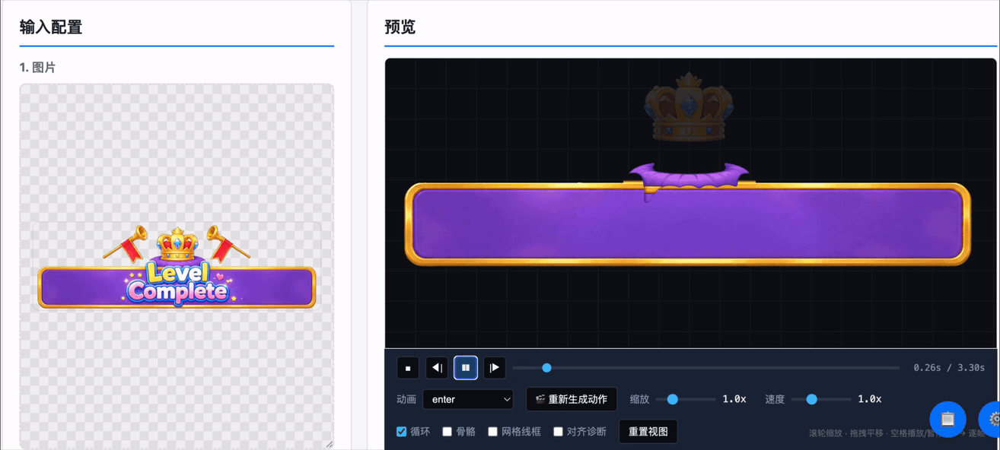
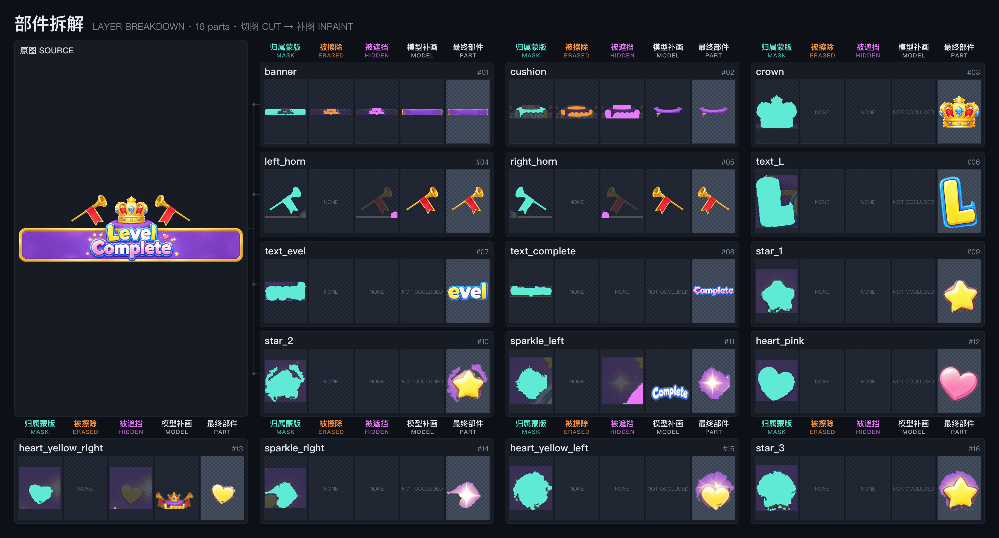
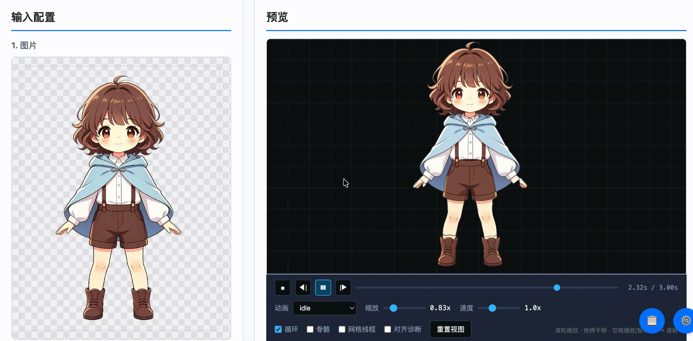
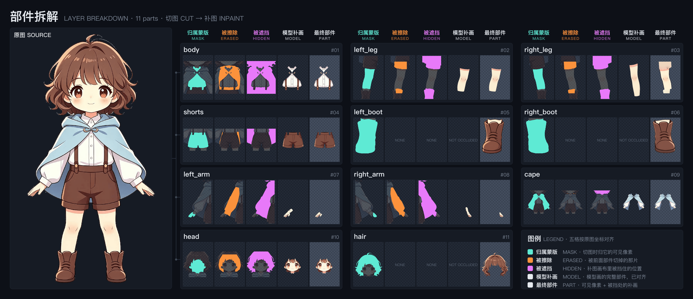

# 更多例子

[English](examples-en.md)

每个例子都是在网页界面上一次生成的结果：上面是预览录屏，下面是部件拆解图
（左边原图，右边每个部件按流程排五格：归属蒙版 → 被擦除 → 被遮挡 → 模型补画 → 最终部件）。

> **效果细节可能需要微调。** 拆件粒度、被挡部分补出来的形状、轴心位置、动作节奏，
> 第一次生成未必都合适，同一份提示词每次跑的结果也会有出入。大多数问题可以直接改提示词重跑；
> 更细的地方（某个部件补得不好、某段动作不顺）可以交给 agent，描述现象让它针对那一处调整。

- [UI 动效：Level Complete 结算界面](#ui-动效level-complete-结算界面)
- [角色：短发女孩](#角色短发女孩)

---

## UI 动效：Level Complete 结算界面

<p align="center">
  
</p>

<p align="center">
  
</p>

**设置**：类别「UI动效」，勾选「按提示词生成动作」，动作名 `enter`。拆成 16 个部件，生成 `enter`（3.3 秒）和 `idle` 两个动作。

**参考提示词**（拆件 + 动作写在一起）：

```
这是一个游戏结算界面「Level Complete」，不是人物。按以下部件拆分：
横幅：最下方横贯整张图的紫色长条，四周有金边；被文字、垫子、星星盖住的部分也属于横幅。
星星：横幅上散落的小黄星、小爱心和白色闪光，每一颗单独拆一块，作为横幅的子部件，轴心在各自中心。
垫子：横幅正上方的紫色圆鼓软垫，是一个完整的椭圆形枕头，四周圆润饱满，表面有放射状褶皱；下半部被「Level」几个字挡住，底边是平滑的圆弧，没有金边、没有脚、没有尖角。皇冠坐在上面。
皇冠：垫子上的金色皇冠，含蓝宝石和红色绒布内衬。
左号角、右号角：左右两支斜举的金色长号，各自含号嘴、管身和挂在管身上的红色燕尾旗。
文字 Level：黄色大字「Level」，其中大写的「L」单独拆一块，「evel」是另一块，两块不要互相包含。
文字 Complete：下方白色描蓝边的「Complete」。

结算入场动画，3.3 秒，不循环，每段动作都要缓入缓出：
0.0–0.35s 横幅从中心向两侧横向展开（横向缩放 0→1.08→1），同时淡入。
0.1–0.5s 垫子从下方弹起：从 0.6 倍放大到 1.1 倍再落回 1 倍。
0.25–0.65s 皇冠从上方掉落到垫子上，弹跳两次，落地时左右摇晃（约 ±6°）后停稳。
0.4–0.6s 字母 L 盖章落下：从 1.3 倍快速变成不透明，缩到 0.92 倍再回到 1 倍。
0.5–0.7s 「evel」同样盖章落下。
0.75–0.95s 「Complete」同样盖章落下。文字落定后保持不动，不再缩放。
0.8–1.2s 左右号角从斜下方滑入并淡入，转到举起的姿势，两边镜像对称。
1.4–2.4s 号角沿管身方向前后吹奏三下（各约 25px 往复）。
1.2–2.6s 皇冠轻轻左右摇摆（±3°）两个来回。
0.4–3.3s 星星一闪一闪：每颗在 0.5 倍和 1.2 倍之间缩放、透明度在 0.3 和 1 之间变化，一次闪烁约 0.4 秒，各颗错开节奏，不要同时闪。
2.7–3.3s 画面保持完整，所有部件都在，不淡出、不消失。
```

**这份提示词里起作用的几处写法**

| 写法 | 解决的问题 |
|---|---|
| 「每一颗单独拆一块，作为横幅的子部件」 | 星星画在横幅上，不拆出来就会在补横幅时被当背景抹掉，也没法单独闪 |
| 「完整的椭圆形枕头……底边是平滑的圆弧，没有金边、没有脚、没有尖角」 | 垫子下半部被字挡住，补图看不到原形，不说清楚会照着挡它的字母轮廓补成锯齿 |
| 「L 单独拆一块，evel 是另一块」 | 想让哪几个字母分开动，就得分开拆 |
| 「文字落定后保持不动」 | 文字持续缩放看起来像在变形 |
| 「画面保持完整，不淡出、不消失」 | 不写的话结尾可能只剩个别部件 |

**还可以继续调的地方**

- 星星、爱心切下来时带了一圈横幅的紫色底，闪烁放大时那圈紫色会跟着变大，在拆解图的最终部件里能看到。
- 部件不会弯曲：红旗能整片摆动，但不会像布那样飘。想让旗子摆，可以在提示词里把旗子从号角上拆出来，轴心放在挂点。
- 勾「整件用模型重绘」边缘更干净，但 16 个部件要十几分钟；某一件补得不好时，用「重试补图」单独重跑那一件更快。

---

## 角色：短发女孩

<p align="center">
  
</p>

<p align="center">
  
</p>

**设置**：类别「角色」。拆成 11 个部件，被头发挡住的脸、被短裤和靴子挡住的腿都补完整了。

---

提示词的通用写法见 README 的[提示词怎么写](../README.md#提示词怎么写)。
